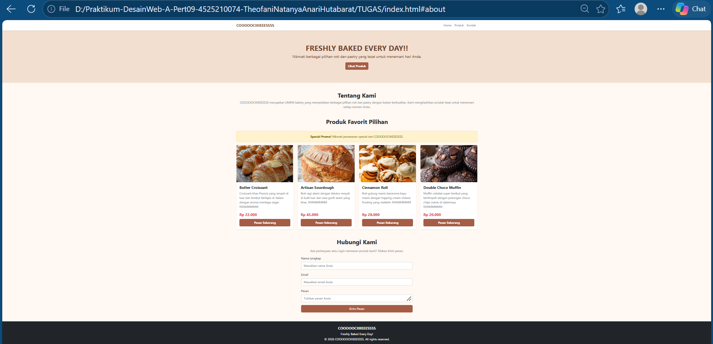
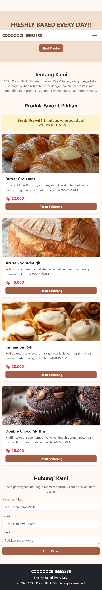

# LAPORAN PRAKTIKUM DESAIN WEB - A

## IDENTITAS

- **Nama:** Theofani Natanya Anari Hutabarat
- **NPM:** 4525210074
- **Mata Kuliah:** Praktikum Desain Web - A
- **Materi:** Pertemuan 10
- **Dosen:** Ari Wibowo, S.Kom., M.Kom., C. Pro.

---

# DESKRIPSI PROYEK

Proyek Pertemuan 10 merupakan tugas individu pembuatan website Company Profile untuk UMKM menggunakan HTML, CSS, dan Bootstrap 5. Pada proyek ini, saya membuat website bakery dengan nama **COOOOOCIIIIEEESSSS**.

Website ini dibuat untuk memperkenalkan usaha bakery serta menampilkan berbagai pilihan produk roti dan pastry kepada pengunjung. Tampilan website dibuat sederhana dengan perpaduan warna cream, cokelat, dan merah agar sesuai dengan konsep bakery.

Dalam pembuatannya, saya menggunakan HTML untuk menyusun struktur halaman, CSS eksternal untuk mengatur tampilan tambahan, serta Bootstrap 5 untuk membantu membuat layout dan komponen website menjadi lebih responsif.

# WEBSITE COMPANY PROFILE COOOOOCIIIIEEESSSS

## Deskripsi

COOOOOCIIIIEEESSSS merupakan konsep website UMKM bakery yang menyediakan berbagai pilihan roti dan pastry. Website ini memiliki beberapa bagian utama, yaitu navbar, hero section, tentang kami, daftar produk, promo, kontak, dan footer.

Website dibuat menggunakan Bootstrap 5 agar tampilannya dapat menyesuaikan ukuran layar desktop maupun smartphone.

## Komponen Website

1. **Navbar** — menggunakan komponen Navbar Bootstrap untuk menampilkan nama brand serta menu Home, Produk, dan Kontak.
2. **Hero Section** — menampilkan judul utama "Freshly Baked Every Day!!", deskripsi singkat, dan tombol untuk melihat produk.
3. **Tentang Kami** — berisi informasi singkat mengenai COOOOOCIIIIEEESSSS.
4. **Alert Promo** — menggunakan komponen Alert Bootstrap untuk menampilkan informasi penawaran spesial.
5. **Katalog Produk** — menampilkan empat produk bakery menggunakan komponen Card.
6. **Modal Produk** — menggunakan komponen Modal Bootstrap untuk menampilkan informasi tambahan mengenai produk.
7. **Form Kontak** — menyediakan kolom nama lengkap, email, dan pesan agar pengunjung dapat mengirimkan pertanyaan.
8. **Footer** — menampilkan nama brand, slogan, dan informasi hak cipta.

## Daftar Produk

Produk yang ditampilkan pada website COOOOOCIIIIEEESSSS terdiri dari:

1. **Butter Croissant** — croissant renyah di luar dan lembut berlapis di dalam dengan harga Rp22.000.
2. **Artisan Sourdough** — roti ragi alami dengan kulit luar renyah dan rasa khas dengan harga Rp45.000.
3. **Cinnamon Roll** — roti gulung manis dengan aroma kayu manis dan topping cream cheese dengan harga Rp28.000.
4. **Double Choco Muffin** — muffin cokelat lembut dengan potongan choco chips dengan harga Rp20.000.

## Penerapan Bootstrap 5

Pada website ini, Bootstrap 5 digunakan untuk membantu proses pembuatan tampilan agar lebih mudah dan responsif.

Beberapa komponen Bootstrap yang digunakan yaitu:

- **Navbar** untuk membuat navigasi website.
- **Container** untuk mengatur posisi dan lebar konten.
- **Grid System** seperti `row`, `col-12`, `col-md-6`, dan `col-lg-3` untuk mengatur susunan produk.
- **Card** untuk menampilkan gambar, nama, deskripsi, dan harga produk.
- **Alert** untuk menampilkan informasi promo.
- **Modal** untuk menampilkan informasi tambahan produk.
- **Form Control** untuk mengatur tampilan kolom pada form kontak.
- **Button** untuk membuat tombol pada website.
- **Spacing Utility** seperti `my-5`, `mb-4`, dan `py-4` untuk mengatur jarak antarbagian.

## Penerapan CSS

Tampilan website diatur menggunakan CSS eksternal pada file `CSS/style.css`.

Beberapa penerapan CSS yang digunakan yaitu:

- `background-color` untuk mengatur warna latar belakang website.
- `.navbar-brand` untuk mengatur warna tulisan nama brand.
- `.hero-section` untuk mengatur warna, teks, dan jarak pada bagian hero.
- `.card-img-top` untuk mengatur tinggi gambar produk dan menggunakan `object-fit: cover`.
- `transition` untuk memberikan efek perubahan pada card.
- `:hover` untuk memberikan efek ketika kursor diarahkan ke card.
- `.btn-danger` untuk mengubah warna tombol menjadi cokelat kemerahan.
- `.contact-form` untuk membatasi lebar form kontak.
- `@media` untuk menyesuaikan padding hero section pada layar yang lebih kecil.

## Penerapan Responsive Design

Website menggunakan Bootstrap Grid System dan media query agar tampilan dapat menyesuaikan ukuran perangkat.

Pada tampilan desktop, produk ditampilkan dalam empat kolom. Pada ukuran tablet, produk disusun menjadi dua kolom, sedangkan pada smartphone produk ditampilkan dalam satu kolom.

Media query juga digunakan untuk menyesuaikan jarak pada hero section ketika website dibuka melalui layar yang lebih kecil.

# PENGUJIAN WEBSITE

## Skenario Pengujian

Pengujian dilakukan untuk memastikan komponen website dapat ditampilkan dengan baik.

| No. | Bagian | Pengujian | Hasil yang Diharapkan |
|---|---|---|---|
| 1 | Navbar | Klik menu navigasi | Berpindah ke bagian halaman yang dituju. |
| 2 | Hero | Klik tombol Lihat Produk | Mengarah ke bagian katalog produk. |
| 3 | Alert | Membuka halaman | Informasi promo tampil dengan baik. |
| 4 | Card Produk | Membuka katalog | Empat produk tampil dengan gambar dan harga. |
| 5 | Modal | Mengaktifkan tombol modal | Informasi produk tampil pada jendela modal. |
| 6 | Form Kontak | Mengisi kolom form | Kolom dapat menerima input pengunjung. |
| 7 | Responsive | Membuka website di smartphone | Tampilan menyesuaikan ukuran layar. |

## Hasil Pengujian

Pengujian dilakukan melalui browser dengan melihat tampilan website pada desktop dan smartphone. Selain itu, dilakukan pemeriksaan terhadap navigasi, katalog produk, komponen Bootstrap, dan form kontak.

Catatan: Form kontak pada proyek ini masih berupa tampilan frontend dan belum terhubung dengan sistem pengiriman pesan atau database.

# RINGKASAN PERUBAHAN, MASALAH, DAN SOLUSI

Pada tugas individu Pertemuan 10 ini, saya membuat website Company Profile untuk UMKM bakery dengan nama COOOOOCIIIIEEESSSS. Website berisi informasi usaha, katalog produk, promo, dan kontak.

Dalam proses pembuatannya, saya menggunakan HTML, CSS, dan Bootstrap 5. Beberapa komponen Bootstrap yang diterapkan yaitu navbar, grid system, card, alert, modal, form, dan button.

Salah satu hal yang perlu diperhatikan adalah pengaturan tampilan agar tetap rapi ketika dibuka melalui perangkat yang berbeda. Solusinya adalah menggunakan Bootstrap Grid System dan media query pada CSS.

Selain itu, penggunaan CSS eksternal membantu mengatur warna, ukuran gambar, efek hover, dan tampilan tombol agar sesuai dengan konsep bakery.

# HASIL TAMPILAN

## Tampilan Desktop

## Tampilan Mobile

# KESIMPULAN

Melalui tugas individu Pertemuan 10, saya mempelajari cara membuat website Company Profile untuk UMKM menggunakan HTML, CSS, dan Bootstrap 5. Saya juga memahami penggunaan berbagai komponen Bootstrap seperti navbar, grid system, card, alert, modal, dan form. Selain itu, saya mempelajari cara mengatur tampilan menggunakan CSS eksternal serta menerapkan responsive design agar website dapat dibuka melalui desktop maupun smartphone. Dengan tugas ini, pemahaman mengenai pembuatan website Company Profile, penggunaan Bootstrap 5, dan pengaturan tampilan website menjadi lebih baik.